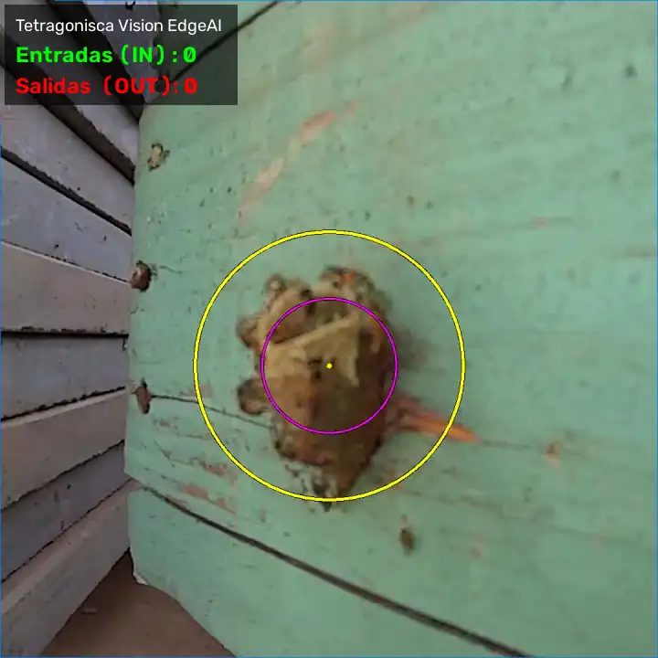
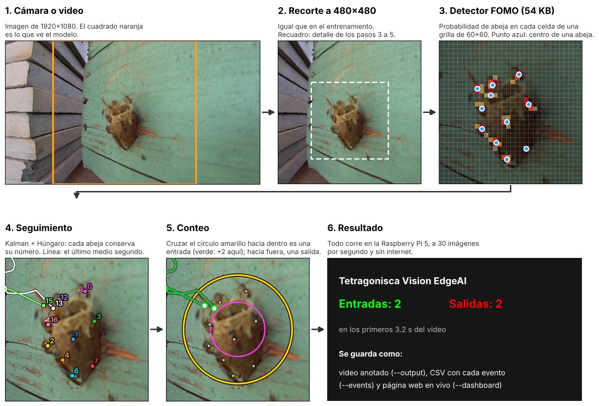

# tetragonisca-vision-edgeai

[](LICENSE)
[](https://www.python.org/)
[](https://edgeimpulse.com/)
[](https://zenodo.org/records/10439007)

Conteo de entradas y salidas de abejas nativas sin aguijón (*Tetragonisca angustula*: angelita, jataí, señorita) en la piquera de la colmena, con visión artificial en una Raspberry Pi 5 y sin conexión a internet.

Un detector FOMO de 54 KB encuentra las abejas en cada imagen. Un algoritmo de seguimiento las sigue de una imagen a la siguiente y cuenta cuántas entran y cuántas salen.

<p align="center"></p>

<p align="center"><i>Los primeros 12 segundos del video <code>0040-1</code>. Cada punto es una abeja con su número de seguimiento. El círculo magenta es la boca de la piquera y el amarillo es el borde donde se cuenta: el tablero suma una entrada o una salida cuando una abeja cruza el círculo amarillo.</i></p>

## El problema

Los meliponicultores de Huyro (Cusco) crían angelitas (*Tetragonisca angustula*), una abeja nativa sin aguijón. Para saber si una colonia está sana hay que abrir la caja, y eso la estresa, así que no se puede hacer seguido. Cuando una colonia se debilita, por frío, falta de flores o el ataque de la abeja limón o de las moscas fóridas, el meliponicultor suele enterarse tarde.

El número de abejas que entran y salen por la piquera muestra la actividad de la colonia sin tocarla. Pero contarlo a mano no es viable. La angelita mide unos 5 mm, vuela muy rápido, al despegar se ve borrosa y frente a la entrada hay guardianas que revolotean sin entrar ni salir.

Este proyecto cuenta entradas y salidas con una cámara y una Raspberry Pi 5 instalada en la propia colmena. Todo se procesa ahí, sin internet. Es el módulo de visión de la colmena inteligente que desarrollamos en la Pasantía 2026-1 de la PUCP (Módulo de Innovación Territorial, Sistema de Innovación Huyro, SI HUYRO), que también mide temperatura, humedad y peso.

Equipo de la pasantía: Brayan Quintana, Susan Lozano, Clara Moreno y Julian Huaman.

## Resultados

| Qué se midió | Resultado |
| :--- | :--- |
| Detección (test de Edge Impulse, modelo v5) | F1 0.94, precisión 1.00, recall 0.89 |
| Conteo en una colmena conocida (video `0040-1`, contado a mano) | Entradas F1 0.84, salidas F1 0.73 |
| Conteo en una colmena que el modelo nunca vio, sin fotos de su fondo (prueba a ciegas) | Entradas F1 0.78, salidas F1 0.66 |
| Velocidad en Raspberry Pi 5 con cámara a 30 fps | 30 imágenes por segundo, en tiempo real |

El conteo se mide evento por evento contra un conteo hecho a mano: cada entrada o salida del programa debe coincidir con una real en el tiempo (±0.5 s) y en el lado de la piquera. Contar al azar da un F1 entre 0.01 y 0.40 en estos videos.

El punto débil son las salidas: la abeja que despega aparece borrosa en una o dos imágenes y el detector no siempre la ve. El método, las tablas completas y los límites están en [docs/VALIDACION.md](docs/VALIDACION.md).

## Cómo funciona



*Una misma imagen del video `0040-1` (segundo 3.2) en cada paso. Del 3 al 5 se muestra solo el detalle de la piquera.*

1. **Detección.** El modelo FOMO, entrenado en Edge Impulse, marca el centro de cada abeja.
2. **Seguimiento.** Cada abeja recibe un identificador que se mantiene mientras se mueve. Las distancias se miden en radios de la piquera y los tiempos en segundos, así que funciona igual con otra resolución o velocidad de cámara.
3. **Conteo.** Se dibuja un círculo sobre la piquera. Una abeja que cruza hacia dentro es una entrada y una que cruza hacia fuera es una salida. Varias reglas descartan a las guardianas que revolotean, los despegues que solo se ven una imagen y los puntos del fondo que el detector confunde con abejas.

El detalle de cada regla está en [docs/TRACKING_ALGORITHM.md](docs/TRACKING_ALGORITHM.md).

## Uso rápido

```powershell
git clone https://github.com/brayanquintana146/tetragonisca-vision-edgeai.git
cd tetragonisca-vision-edgeai
pip install -r requirements.txt
```

Contar en un video, con la configuración recomendada:

```powershell
python main.py --video examples/videos/0040-1.mp4 --model models/v5_fomo_borrosas_480_int8.lite --roi-x 900 --roi-y 600 --roi-r 220 --crop-roi --counter hibrido --max-gate 0.9 --max-gate-tentative 1.2 --accel-std 260 --threshold 0.7 --max-lost 0.3 --proj-min-speed 3.0 --flash-exits --static-s 2 --core 0.5 --cancel-s 1.0 --rep-s 60 --output video_conteo.mp4 --events eventos.csv
```

Al terminar, la consola muestra las entradas, las salidas y la velocidad. `--output` guarda el video anotado y `--events` un CSV con cada evento (tiempo, tipo y posición).

Para ver el conteo en una ventana, agregar `--show --no-output --num-threads 4` (se cierra con `q`). Guardar el video con `--output` frena el análisis, y en Windows la ventana va a la velocidad real del video si el equipo analiza más de 60 imágenes por segundo.

Opciones principales:

| Opción | Para qué sirve |
| :--- | :--- |
| `--video` | Archivo de video, o cámara (`0`, `/dev/video0`) |
| `--model` | Modelo `.lite` de la carpeta `models/` (si no se indica, la v5) |
| `--roi-x`, `--roi-y`, `--roi-r` | Centro y radio, en píxeles, del círculo sobre la piquera |
| `--crop-roi` | Recorta un cuadrado centrado en la piquera antes del modelo, como en el entrenamiento |
| `--track-scale` | Tamaño de referencia de la abeja cuando el círculo es chico (por ejemplo `--roi-r 100 --track-scale 220`) |
| `--dashboard` | Página web con el conteo en vivo, en el puerto 5000 |
| `--show` | Abre una ventana con el conteo (solo en PC con pantalla; `q` para cerrar) |
| `--num-threads` | Núcleos para el modelo (4 en la Raspberry Pi 5 y en un PC) |
| `--no-output` | No guarda el video anotado (más rápido) |

`python main.py --help` lista todas las opciones.

**En una colmena nueva** solo hay que ubicar la piquera: correr con `--no-output --snapshot-every 30` y revisar en `snapshots/` que el círculo caiga sobre la boca. Para una colmena que el modelo no conoce se agregan `--in-max-age 3 --in-park-s 0.15 --park-s 0.9`, la configuración evaluada en la prueba a ciegas.

## Modelos

El nombre de cada archivo empieza con su versión en Edge Impulse.

| Versión | Datos de entrenamiento | Entrada | F1 (test) |
| :--- | :--- | :---: | :---: |
| v3 | Colmenas 001, 003, 004 y 005 | 320×320 | 0.93 |
| **v5** | v3 + 273 imágenes de abejas borrosas en vuelo | 480×480 | **0.94** |
| v7 | v5 sin la colmena 005 (para la prueba a ciegas) | 480×480 | 0.93 |

En `models/` están las versiones v3 a v8. La v5 es la recomendada y la que usa `main.py` si no se indica `--model`. El historial completo y la guía para entrenar están en [docs/ENTRENAMIENTO.md](docs/ENTRENAMIENTO.md).

Proyectos públicos en Edge Impulse: [modelo base](https://studio.edgeimpulse.com/studio/1073834) (solo colmena 004) y [modelo multicolmena](https://studio.edgeimpulse.com/studio/1108884).

## Estructura del repositorio

```text
tetragonisca-vision-edgeai/
├── main.py        # Detección + seguimiento + conteo (video o cámara)
├── src/           # Seguimiento, contador, panel web
├── models/        # Modelos FOMO exportados (.lite)
├── bench/         # Evaluación: comparar eventos, guardar y repetir detecciones
├── tools/         # Anotar a mano entradas y salidas, editar cajas, probar la cámara
├── scripts/       # Preparación de datos para Edge Impulse
├── data/          # Conteos a mano (gt_*.csv) y datos de entrenamiento
├── tests/         # Pruebas del seguimiento y del contador (pytest)
├── docs/          # Documentación
└── deployment.md  # Instalación en la Raspberry Pi 5
```

## Documentación

| Documento | Contenido |
| :--- | :--- |
| [docs/GUIA_PARAMETROS.md](docs/GUIA_PARAMETROS.md) | Cómo correr el conteo y qué hace cada parámetro, en palabras simples |
| [docs/VALIDACION.md](docs/VALIDACION.md) | Cómo se midió el conteo, resultados y límites |
| [docs/TRACKING_ALGORITHM.md](docs/TRACKING_ALGORITHM.md) | Algoritmo de seguimiento y reglas de conteo |
| [docs/ENTRENAMIENTO.md](docs/ENTRENAMIENTO.md) | Preparar datos, entrenar en Edge Impulse e historial de versiones |
| [deployment.md](deployment.md) | Instalación y uso en la Raspberry Pi 5 |
| [docs/TRABAJO_FUTURO.md](docs/TRABAJO_FUTURO.md) | Qué sigue: más datos, otras colmenas e instalación en la colmena |

## Pruebas

```powershell
pytest
```

Las 16 pruebas de `tests/` revisan el seguimiento y el contador con recorridos sintéticos: una abeja que entra, una que sale, una guardiana que se asoma y vuelve, un punto fijo del fondo que parpadea, y el mismo recorrido a otra resolución y otra velocidad de cámara.

## Datos

Se usa el conjunto de datos público de Leocádio et al. ([Zenodo, DOI 10.5281/zenodo.10439007](https://zenodo.org/records/10439007)): videos y fotos etiquetadas de seis colmenas de *Tetragonisca angustula*, grabados con una cámara SONY HDR-AS20 (1920×1080, 60 fps). Licencia de los datos: CC BY-NC 4.0.

> Leocádio, R. R. V., Segundo, A. K. R., Pessin, G. *Multiple Object Tracking in Native Bee Hives: A Case Study with Jataí in the Field*. BRACIS 2023. <https://doi.org/10.1007/978-3-031-45392-2_12>

## Licencia

Código bajo licencia [BSD 3-Clause](LICENSE).
