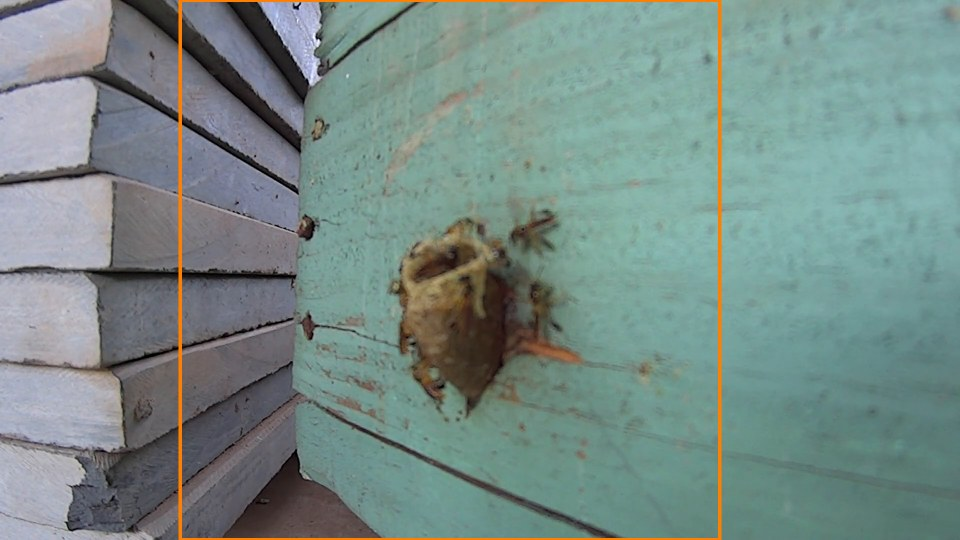
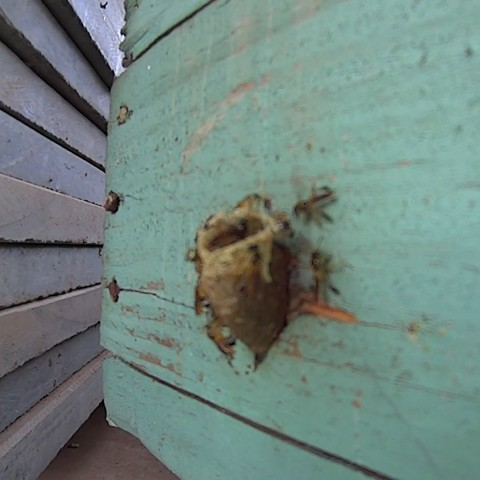
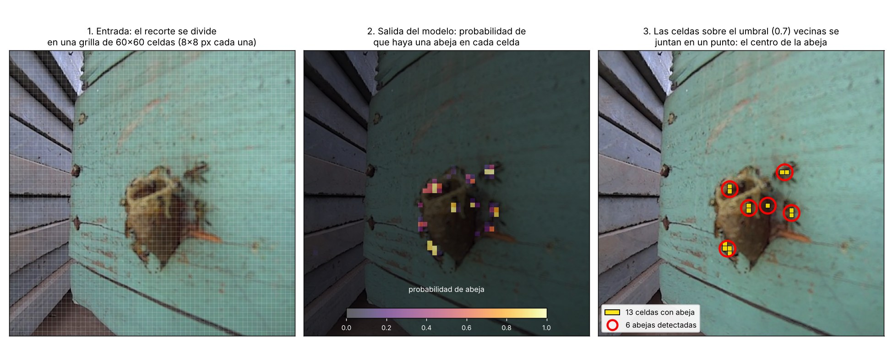
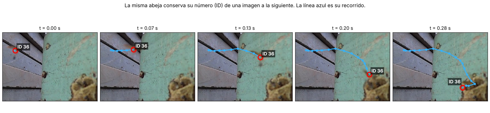
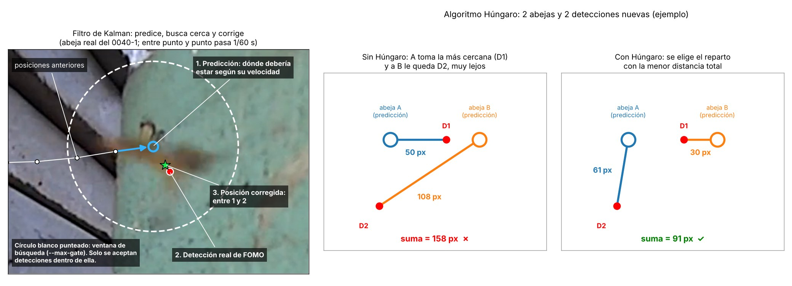
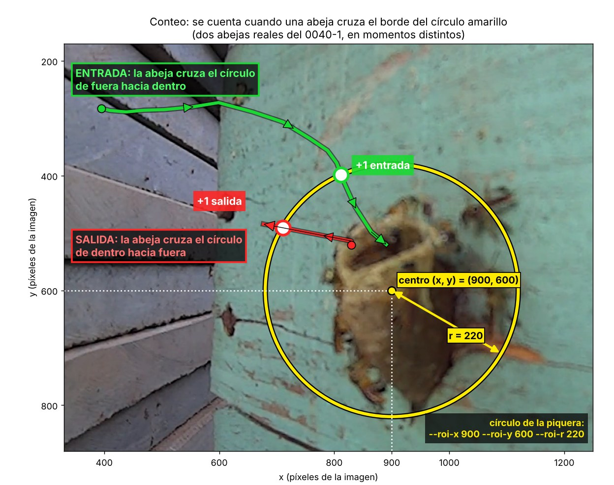
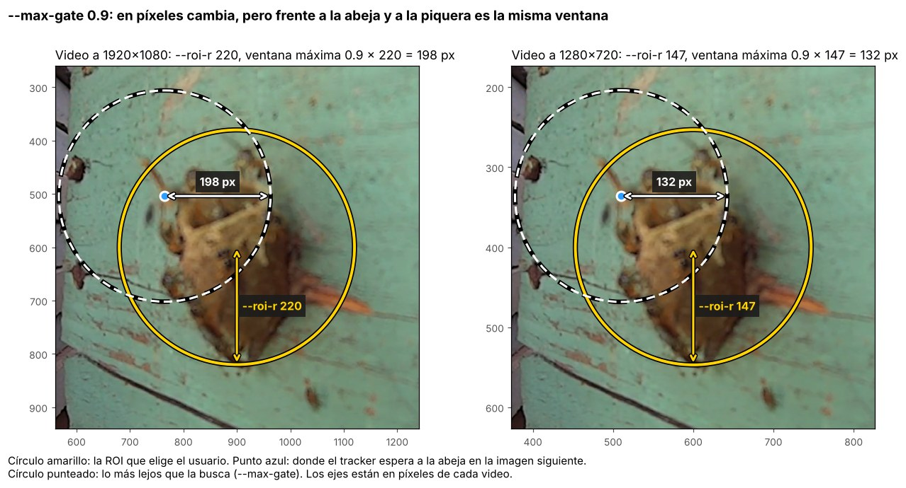

# Guía para correr el conteo y entender sus parámetros

Esta guía explica cómo correr `main.py` en los casos más comunes y qué hace cada parámetro, en palabras simples. Para el detalle técnico y los números de cada regla, ver [TRACKING_ALGORITHM.md](TRACKING_ALGORITHM.md). Para cómo se midieron los resultados, ver [VALIDACION.md](VALIDACION.md).

## 1. La idea general

En cada imagen del video pasan cuatro cosas, en este orden:

```text
1. Recorte   ─►  2. Detección  ─►  3. Seguimiento  ─►  4. Conteo
(--crop-roi)     (FOMO, --model)    (tracker, Kalman)    (círculo de la piquera)
```

1. **Recorte.** Se toma un cuadrado alrededor de la piquera y se reduce al tamaño que espera el modelo (480×480 en la v5).

   Ejemplo con el video `0040-1` y `--roi-x 900 --roi-y 600 --roi-r 220`. El cuadrado naranja, centrado en la piquera, es lo que se recorta (1080×1080 píxeles):

   | Imagen original (1920×1080) | Lo que ve el modelo (480×480) |
   | :---: | :---: |
   |  |  |

   Sin `--crop-roi`, el modelo recibiría la imagen completa aplastada a 480×480 y las abejas se verían más chicas y deformadas. Con el recorte llegan del mismo tamaño que en el entrenamiento.

2. **Detección.** El modelo FOMO divide la imagen en una grilla de celdas (60×60 en la v5) y da, para cada celda, la probabilidad de que haya una abeja. Las celdas vecinas con abeja se juntan en un solo punto: el centro de la abeja. FOMO no dibuja cajas, solo da centros. Por eso es tan liviano (54 KB).

   

   Ejemplo real con la v5 en el mismo recorte de arriba: 13 celdas pasan el umbral de 0.7 y se juntan en 6 abejas (las que están en la piquera). En la imagen 2 se ve que el modelo solo "se enciende" sobre las abejas; la madera y el tubo quedan casi en 0.

   La v5 es el modelo recomendado: es el que mejor detecta (F1 0.94 en el test de Edge Impulse). Las versiones siguientes no son mejoras sino experimentos: v6 usa 320×320 y pierde abejas, v7 y v8 se entrenaron sin la colmena 005 para la prueba a ciegas, y v9 (YOLO) era 10 veces más lento. El detalle está en [ENTRENAMIENTO.md](ENTRENAMIENTO.md).
3. **Seguimiento.** El tracker une los puntos de una imagen con los de la siguiente, para saber que "esta abeja es la misma de hace un instante". Usa un **filtro de Kalman**, que predice dónde estará cada abeja según su velocidad, y el **algoritmo Húngaro**, que reparte las detecciones entre las abejas de forma que la distancia total sea la menor posible.

   

   Una abeja real del `0040-1` llega volando a la piquera. En cada imagen el tracker la reconoce como la misma (ID 36) aunque recorre unos 50 píxeles entre una imagen y la siguiente.

   

   - **Kalman (izquierda, la misma abeja):** con sus posiciones anteriores calcula su velocidad y **predice** dónde estará en la siguiente imagen (círculo azul). Solo busca detecciones dentro de una ventana alrededor de esa predicción (círculo blanco punteado, `--max-gate`). Cuando FOMO la detecta (punto rojo), **corrige** su posición a un punto intermedio (estrella verde): no confía del todo ni en la predicción ni en la detección.
   - **Húngaro (derecha, ejemplo con números simples):** con varias abejas y varias detecciones, repartir "cada abeja toma la más cercana" puede salir mal: A se queda con D1 y a B le toca D2, a 108 px, y los ID se intercambian. El algoritmo Húngaro prueba los repartos posibles de forma eficiente y elige el de menor distancia total (91 px contra 158 px).
4. **Conteo.** Sobre la piquera se dibuja un círculo amarillo. Una abeja que cruza de fuera hacia dentro es una **entrada**; de dentro hacia fuera, una **salida**. Varias reglas descartan lo que no es una entrada o salida real: guardianas que revolotean, abejas que se asoman y vuelven, y manchas del fondo que el modelo confunde con abejas.

   

   Dos abejas reales del `0040-1`. La verde viene de fuera y cruza el borde hacia dentro: se cuenta una entrada. La roja estaba en la piquera y cruza el borde hacia fuera: se cuenta una salida. El punto blanco marca el momento en que se cuenta.

### Dos unidades que conviene entender

- **Escala (en "radios").** El centro y el radio del círculo (`--roi-x`, `--roi-y`, `--roi-r`) sí van en píxeles: se eligen mirando la imagen, para que el círculo rodee la piquera. Después, el tracker usa ese radio como unidad de medida: todas sus distancias (cuánto puede moverse una abeja entre imágenes, qué tan cerca deben estar dos detecciones para ser la misma abeja) se dan en "radios". Con `--track-scale` se usa otro valor como unidad, sin cambiar el círculo. Así los mismos parámetros sirven en un video de 1920×1080 y en uno de 1280×720: solo cambia el círculo.

  

  La misma imagen del `0040-1` a dos resoluciones. A 1920×1080 el círculo mide 220 px y `--max-gate 0.9` deja buscar a la abeja hasta 198 px; a 1280×720 el círculo mide 147 px y la misma opción da 132 px. En píxeles es distinto, pero frente a la abeja y a la piquera es la misma ventana.

- **Tiempo (en segundos).** Los tiempos se miden en segundos reales, no en imágenes. Así sirven igual a 60 fps (videos del dataset) y a 30 fps (cámara C930e).

## 2. Comandos listos para usar

En Windows, una línea larga se puede partir con `` ` `` al final de cada línea en PowerShell. Aquí se escribe todo en una línea para poder copiarla.

### a) Video de ejemplo, con la configuración recomendada

```powershell
python main.py --video examples/videos/0040-1.mp4 --model models/v5_fomo_borrosas_480_int8.lite --roi-x 900 --roi-y 600 --roi-r 220 --crop-roi --counter hibrido --max-gate 0.9 --max-gate-tentative 1.2 --accel-std 260 --threshold 0.7 --max-lost 0.3 --proj-min-speed 3.0 --flash-exits --static-s 2 --core 0.5 --cancel-s 1.0 --rep-s 60 --num-threads 4 --show --no-output --events eventos.csv
```

Resultado esperado: unas 32 entradas y 44 salidas (el valor exacto puede variar en 1 o 2 según el equipo: ver la sección 6). `--show` abre una ventana con el video a su velocidad real; se cierra con la tecla `q`.

Para guardar el video anotado, cambiar `--no-output` por `--output video_conteo.mp4`. Guardar video cuesta tiempo: en las pruebas el análisis bajó a menos de la mitad de velocidad, y la ventana puede verse más lenta que el video real.

### b) Colmena que el modelo nunca vio

Igual que (a), cambiando el círculo para esa colmena y agregando las reglas contra manchas del fondo:

```powershell
python main.py --video VIDEO.mp4 --model models/v5_fomo_borrosas_480_int8.lite --roi-x X --roi-y Y --roi-r R --crop-roi --counter hibrido --max-gate 0.9 --max-gate-tentative 1.2 --accel-std 260 --threshold 0.7 --max-lost 0.3 --proj-min-speed 3.0 --flash-exits --static-s 2 --core 0.5 --cancel-s 1.0 --rep-s 60 --in-max-age 3 --in-park-s 0.15 --park-s 0.9 --events eventos.csv
```

Esta es la configuración que se usó en la prueba a ciegas. Antes, ubicar la piquera (ver sección 4).

### c) Cámara en vivo (PC o Raspberry Pi)

```powershell
python main.py --video 0 --cam-width 1280 --cam-height 720 --cam-fps 30 --model models/v5_fomo_borrosas_480_int8.lite --roi-x X --roi-y Y --roi-r R --crop-roi --counter hibrido --max-gate 0.9 --max-gate-tentative 1.2 --accel-std 260 --threshold 0.7 --max-lost 0.3 --proj-min-speed 3.0 --flash-exits --static-s 2 --core 0.5 --cancel-s 1.0 --rep-s 60 --no-output --show
```

En la Raspberry Pi: `--video /dev/video0`, `--num-threads 4` y, sin monitor, `--dashboard` en vez de `--show`. Sin `--cam-width` y `--cam-height`, Windows abre la cámara a 640×480 y el círculo puede quedar fuera de la imagen.

> La exactitud con la cámara en vivo a 30 fps todavía no está medida: los resultados publicados son con videos del dataset a 60 fps.

### d) Medir contra un conteo a mano

```powershell
python bench/compare_events.py data/gt_0040-1.csv eventos.csv --tol 0.5 --max-angle 40 --roi-x 900 --roi-y 600
```

Cada evento del programa debe coincidir con uno anotado a mano: mismo tipo, a menos de 0.5 s y del mismo lado de la piquera (±40°). Muestra precisión, recall, F1 y el F1 que daría contar al azar.

## 3. Parámetros, uno por uno

En cada tabla: **defecto** es el valor si no se escribe la opción; **recomendado** es el de la configuración de la sección 2.

### 3.1 Entrada y salida de archivos

| Opción | Defecto | Qué hace |
| :--- | :--- | :--- |
| `--video` | (obligatorio) | Archivo de video, o número de cámara (`0`) o `/dev/video0` en la Pi. |
| `--model` | `models/v5_fomo_borrosas_480_int8.lite` | Modelo `.lite` a usar. La v5 es la que mejor detecta y la de los resultados publicados. Las otras versiones de `models/` sirven para repetir pruebas anteriores, por ejemplo la v7 para la prueba a ciegas. |
| `--output` | `output_result.mp4` | Video con las anotaciones dibujadas. |
| `--no-output` | apagado | No guarda video. Ahorra tiempo y disco, sobre todo en la Pi. |
| `--events` | ninguno | CSV con una fila por cada entrada o salida: tiempo, tipo (IN/OUT), ID y posición. Es lo que se compara contra el conteo a mano. |
| `--log` | ninguno | CSV con una fila por imagen: totales acumulados y velocidad. |
| `--show` | apagado | Abre una ventana con el video anotado (solo en PC con pantalla); se cierra con `q`. Con un video de archivo lo muestra a su velocidad real: si el equipo analiza más rápido, espera; si analiza más lento, se ve en cámara lenta. La ventana se refresca como máximo 30 veces por segundo, aunque el video tenga 60: se ve igual de fluido y el análisis no se frena. La imagen se achica al tamaño de la ventana con buena calidad y, en Windows, se evita que la escala de pantalla la ponga borrosa. El conteo es el mismo con o sin ventana. |
| `--dashboard` | apagado | Página web con el conteo en vivo, en `http://IP:5000`. Sirve para ver la Pi desde el celular o la laptop. |
| `--snapshot-every N` | 0 (apagado) | Guarda una imagen anotada cada N imágenes en `--snapshot-dir` (por defecto `snapshots/`). Sirve para revisar sin pantalla. |

### 3.2 Cámara y velocidad

| Opción | Defecto | Qué hace |
| :--- | :--- | :--- |
| `--cam-width`, `--cam-height` | del driver | Resolución pedida a la cámara. Con la C930e: 1280 × 720. |
| `--cam-fps` | del driver | Imágenes por segundo pedidas a la cámara. La C930e llega a 30. |
| `--num-threads` | 1 | Núcleos del procesador para el modelo. Con 4 el modelo corre casi el doble de rápido y cuenta exactamente lo mismo. En la Pi 5 y en un PC: 4. |
| `--skip-frames N` | 1 | Analiza 1 de cada N imágenes. Acelera, pero una abeja que despega puede quedar en una sola imagen o en ninguna. Por debajo de ~15 imágenes por segundo efectivas las salidas se cuentan mal. Con cámara en vivo no se usa. |

### 3.3 El círculo de la piquera

| Opción | Defecto | Recomendado | Qué hace |
| :--- | :--- | :--- | :--- |
| `--roi-x`, `--roi-y` | 900, 640 | según el video | Centro del círculo, en píxeles. Va sobre la boca del tubo. |
| `--roi-r` | 200 | según el video | Radio del círculo, en píxeles. Cruzar ese borde es lo que cuenta como entrada o salida. |
| `--crop-roi` | apagado | **encendido** | Recorta un cuadrado centrado en la piquera antes de pasarlo al modelo, en lugar de aplastar toda la imagen. Así las abejas llegan al modelo con el mismo tamaño que en el entrenamiento. El cuadrado se dibuja en naranja. |
| `--core` | ninguno | 0.5 | La **boca** de la piquera: un círculo interior (magenta) de esa fracción del radio. Una salida solo cuenta si la abeja pasó por la boca; una entrada solo si llega a ella. Así no cuentan las guardianas que vuelan frente al tubo y cruzan el borde sin entrar. |
| `--track-scale` | = `--roi-r` | 220 si el círculo es chico | Tamaño de referencia que usa el tracker para medir distancias. Permite un círculo chico (para dejar fuera a las guardianas) sin que el tracker parta una abeja en dos. Ejemplo: `--roi-r 100 --track-scale 220`. |

**Por qué `--track-scale` existe:** si el círculo mide 100 px, el tracker juntaría celdas de FOMO solo a menos de 25 px (0.25 radios), y una abeja grande se vería como dos. Con `--track-scale 220`, el círculo decide **dónde** se cuenta y la escala decide **cómo** se sigue a la abeja.

### 3.4 Detección

| Opción | Defecto | Recomendado | Qué hace |
| :--- | :--- | :--- | :--- |
| `--threshold` | 0.55 | 0.7 | Confianza mínima para que una detección cree una abeja **nueva**. Más alto: menos abejas falsas, pero puede perder abejas borrosas. |
| `--assoc-threshold` | 0.35 | 0.35 | Confianza mínima para **seguir** a una abeja que ya existe. Es más bajo porque una abeja en movimiento sale borrosa y el modelo duda más. |

**Doble umbral:** una detección débil puede continuar a una abeja conocida, pero solo una fuerte crea una nueva. Además, una abeja nueva necesita 2 detecciones seguidas para tener un ID; una mancha que aparece una sola vez no se convierte en abeja.

### 3.5 Seguimiento (tracker)

| Opción | Defecto | Recomendado | Qué hace |
| :--- | :--- | :--- | :--- |
| `--tracker` | v2 | v2 | `v2`: Kalman + Húngaro, en radios y segundos. `v1`: el primer tracker, en píxeles y frames. Se deja solo para comparar. |
| `--max-gate` | 1.2 | 0.9 | Distancia máxima, en escalas, entre donde el Kalman predijo a la abeja y la detección que se le asigna. Más chico: las abejas no "saltan" a una vecina. Más grande: se siguen mejor los movimientos rápidos. |
| `--max-gate-tentative` | = `--max-gate` | 1.2 | Lo mismo, pero para abejas recién aparecidas que aún no tienen ID confirmado. Más grande, para enlazar una abeja que entra volando rápido. |
| `--accel-std` | 40 | 260 | Cuánto puede acelerar una abeja según el Kalman (escalas/s²). Un valor alto le dice al filtro que la abeja puede cambiar de velocidad de golpe, como al despegar. |
| `--max-lost` | 0.6 | 0.3 | Segundos que una abeja puede pasar sin ser detectada antes de darla por perdida. Más corto: menos "fantasmas" que roban detecciones a otras abejas. |
| `--max-disappeared`, `--max-distance` | 20, 250 | – | Solo para `--tracker v1` (en frames y píxeles). |

**El filtro de Kalman en una frase:** guarda la posición y la velocidad de cada abeja, predice dónde estará en la siguiente imagen y corrige esa predicción con la detección real. Si la abeja no se ve por un momento, la sigue moviendo según su velocidad, y su incertidumbre crece.

**El algoritmo Húngaro en una frase:** cuando hay varias abejas y varias detecciones, prueba todas las combinaciones de forma eficiente y elige la que da la menor distancia total. Así dos abejas que se cruzan no intercambian su identidad.

### 3.6 Conteo

| Opción | Defecto | Recomendado | Qué hace |
| :--- | :--- | :--- | :--- |
| `--counter` | v2 | **hibrido** | `v2`: un evento por abeja, según dónde nació y dónde terminó su recorrido. `hibrido`: cuenta cada salida que cruza el borde, aunque la abeja ya tuviera un recorrido largo, y las entradas como `v2`. |
| `--cancel-s` | 0.5 | 1.0 | Si una abeja sale y vuelve a entrar en menos de estos segundos, no cuenta ninguno de los dos cruces: solo se asomó. |
| `--proj-min-speed` | 1.5 | 3.0 | Cuando se pierde una abeja cerca del borde, se proyecta hacia dónde iba. Solo se proyecta si iba a más de esta velocidad (escalas/s). Más alto: menos salidas inventadas. Con `--flash-exits` esta proyección se apaga. |

**Por qué existe `hibrido`:** en la piquera hay recorridos que duran 10 o 20 segundos, porque el tracker se queda pegado a una guardiana y salta a la abeja que despega. Con `v2`, ese recorrido ya había contado algo y la salida se perdía.

### 3.7 Salidas difíciles: despegues borrosos

El punto débil del sistema son las salidas. Una abeja que despega aparece borrosa en solo 1 o 2 imágenes, y el tracker pide 2 detecciones seguidas para crear una abeja.

| Opción | Defecto | Recomendado | Qué hace |
| :--- | :--- | :--- | :--- |
| `--flash-exits` | apagado | **encendido** | Cuenta como salida una "aparición fugaz": 1 a 3 detecciones fuera del círculo que se alejan de la piquera y que no pertenecen a una abeja ya seguida. Recupera despegues que el tracker no alcanza a seguir. |
| `--static-s` | ninguno | 2 | Descarta una salida si en ese mismo punto ya había una detección en los 2 segundos anteriores. Una abeja que se va no sale de donde ya había algo quieto (una sombra, por ejemplo). |
| `--rep-s` | ninguno | 60 | Recuerda, durante 60 s, los puntos fijos donde el modelo "ve" algo a ratos. Una salida fugaz en un punto que ya se encendió varias veces no cuenta: es fondo, no una abeja. Se aprende del propio video, sin fotos del fondo. |
| `--rep-k` | 2 | 2 | Cuántas veces tiene que encenderse un punto para considerarlo fondo. |

En el `0040-1`, `--flash-exits` subió el F1 de salidas de 0.47 a 0.69, y con `--core 0.5 --cancel-s 1.0` a 0.72.

### 3.8 Colmenas nuevas: manchas del fondo

En una colmena que el modelo no conoce, algunas manchas del fondo se detectan como abeja casi todo el tiempo. El tracker las sigue como abejas quietas y, cuando una abeja real pasa cerca, salta a ella y cuenta una entrada falsa.

| Opción | Defecto | Para colmena nueva | Qué hace |
| :--- | :--- | :--- | :--- |
| `--in-max-age` | ninguno | 3 | Una entrada solo cuenta si esa abeja apareció hace 3 s o menos. La abeja que llega entra enseguida (la más lenta del `0040-1` tardó 1.7 s); un recorrido viejo que "entra" es una guardiana o una mancha. |
| `--in-park-s` | ninguno | 0.15 | Una entrada no cuenta si justo antes la "abeja" estuvo quieta fuera del círculo 0.15 s o más: era una mancha que saltó a una abeja. |
| `--park-s` | ninguno | 0.9 | Un recorrido quieto 0.9 s o más fuera del círculo se marca como estacionado, para que no tape los despegues que pasan cerca. En la prueba a ciegas no ayudó: agregó 4 salidas falsas. Se mantiene porque es parte de la configuración congelada de esa prueba. |

### 3.9 Reglas que dependen de otras

- `--static-s`, `--rep-s` y `--park-s` necesitan `--flash-exits`. Si falta, `main.py` se detiene y lo dice.
- `--flash-exits`, `--in-max-age` y `--in-park-s` necesitan `--counter hibrido`. Si falta, `main.py` se detiene y lo dice.
- `--core`, `--cancel-s` y `--proj-min-speed` solo tienen efecto con `--counter hibrido`. Sin él no dan error, pero no hacen nada.

## 4. Cómo ubicar la piquera en un video nuevo

1. Correr unos segundos con `--no-output --snapshot-every 30` y el círculo en una posición aproximada.
2. Abrir la primera imagen de `snapshots/` y ver dónde quedó el círculo amarillo.
3. Ajustar `--roi-x`, `--roi-y` y `--roi-r` hasta que el círculo rodee la boca del tubo y la zona donde las abejas aterrizan. Si el círculo se sale de la imagen, `main.py` avisa por qué lado y qué valores son válidos.
4. Si hay guardianas que vuelan frente al tubo, achicar el círculo y agregar `--track-scale` con el tamaño anterior (ver 3.3).

**Regla para una prueba honesta:** en un video de prueba solo se elige el círculo, mirando la primera imagen y antes de contar. Nada más se ajusta después de ver el resultado.

| Video | `--roi-x` | `--roi-y` | `--roi-r` | Extra |
| :--- | :---: | :---: | :---: | :--- |
| `0040-1` (colmena 004) | 900 | 600 | 220 | – |
| `0031-2` (colmena 003) | 855 | 465 | 100 | `--track-scale 220` |
| `0020-1` (colmena 002) | 570 | 815 | 180 | – |
| Colmena 001 | ver `data/rois_001.csv` | | | la cámara se movió entre videos |

## 5. Qué muestra la pantalla

- **Círculo amarillo:** borde de conteo.
- **Círculo magenta:** boca de la piquera (`--core`).
- **Rectángulo naranja:** la parte de la imagen que ve el modelo (`--crop-roi`).
- **Punto rojo con "ID n":** una abeja seguida por el tracker.
- **Puntos azules que se desvanecen:** el recorrido reciente de cada abeja.
- **Tablero arriba a la izquierda:** entradas (verde) y salidas (rojo) acumuladas.

Al terminar, la consola muestra el resumen: entradas, salidas, velocidad y si el análisis fue al ritmo del video.

## 6. Preguntas frecuentes

**¿Por qué se ve lento o en cámara lenta?**
Casi siempre por una de estas tres cosas, y ninguna cambia el conteo:
1. `--output` guarda un video de 1920×1080 y baja la velocidad a menos de la mitad. Usar `--no-output` si no hace falta el video.
2. Falta `--num-threads 4`: sin eso el modelo usa un solo núcleo.
3. Con `--show` y un equipo que analiza menos de 60 imágenes por segundo, la ventana va en cámara lenta porque el video llega a 60.

Para saber cuál es, correr sin `--show` y sin `--output` y mirar en el RESUMEN las líneas **Llegan** (lo que manda el video), **Puede analizar** (lo que da el equipo) y **Analizó** (lo que se logró en total). Si "Puede analizar" supera a "Llegan", el equipo alcanza y lo lento es la ventana o el video guardado. En un PC con Windows de pruebas: 125 imágenes por segundo contra 60, y el minuto de video se procesó en 47 segundos.

**¿Por qué el conteo da distinto en otro computador?**
En Windows el modelo corre con TensorFlow y en Linux y la Raspberry Pi con LiteRT. Los dos motores dan resultados apenas distintos en algunas celdas del modelo, y eso mueve uno o dos eventos. En el `0040-1` con la configuración recomendada salió 32 entradas y 44 salidas en Linux y 33 y 46 en Windows. Entre equipos coinciden más o menos el 55 al 65 % de los eventos individuales, aunque el total sale parecido ([VALIDACION.md](VALIDACION.md)).

**¿Por qué FOMO y no YOLO?**
FOMO pesa 54 KB y en la Pi 5 analiza unas 90 imágenes por segundo. Se probó un YOLO en Edge Impulse (v9): daba mAP@50 de 0.62 en test y tardaba 188 ms por imagen en una Pi 4, unas 10 veces más lento. Para contar solo hace falta el centro de cada abeja, no su caja.

**¿Por qué se mide con F1 evento por evento y no con totales?**
Un total puede coincidir por casualidad: 30 entradas contadas pueden ser 15 reales y 15 falsas. Comparar evento por evento (tiempo ±0.5 s y lado de la piquera) obliga a que cada conteo corresponda a una abeja real. El F1 combina precisión (cuántos de los contados son reales) y recall (cuántos de los reales se contaron).

**¿Qué es el "F1 al azar"?**
Es el F1 que se obtiene moviendo en el tiempo los mismos eventos del programa. Si el resultado real no lo supera claramente, el programa no está contando mejor que el azar. En estos videos va de 0.01 a 0.40.

**¿Qué es la prueba a ciegas?**
Se entrenó un modelo (v7) sin ninguna imagen de la colmena 005, se congelaron las reglas con un commit y se corrió una sola vez en dos videos de esa colmena, contados a mano sin mirar el resultado. Dio F1 0.78 en entradas y 0.66 en salidas. Es una sola colmena y 64 eventos, así que es una primera evidencia, no una prueba definitiva.

**¿Por qué las salidas salen peor que las entradas?**
La abeja que entra camina o aterriza despacio y se ve en muchas imágenes. La que sale despega muy rápido y aparece borrosa en una o dos. El límite está en el detector, no en el tracker: incluso el modelo que conoce la colmena llega a ~0.77 en salidas.

**¿Por qué tantos parámetros?**
Cada regla resuelve un error concreto que se vio en un video: guardianas (`--core`), abejas que se asoman (`--cancel-s`), despegues borrosos (`--flash-exits`), sombras (`--static-s`) y manchas del fondo (`--rep-s`, `--in-max-age`, `--in-park-s`). Para un uso normal basta con copiar la configuración recomendada y ajustar solo el círculo.
